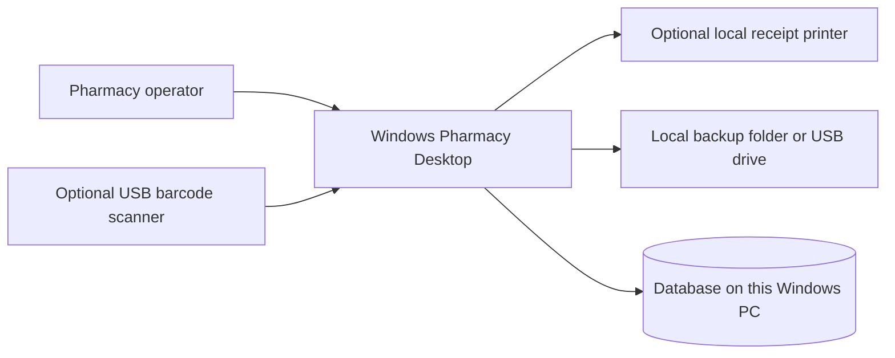
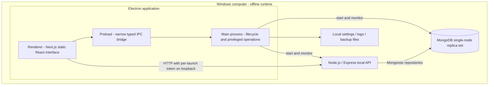
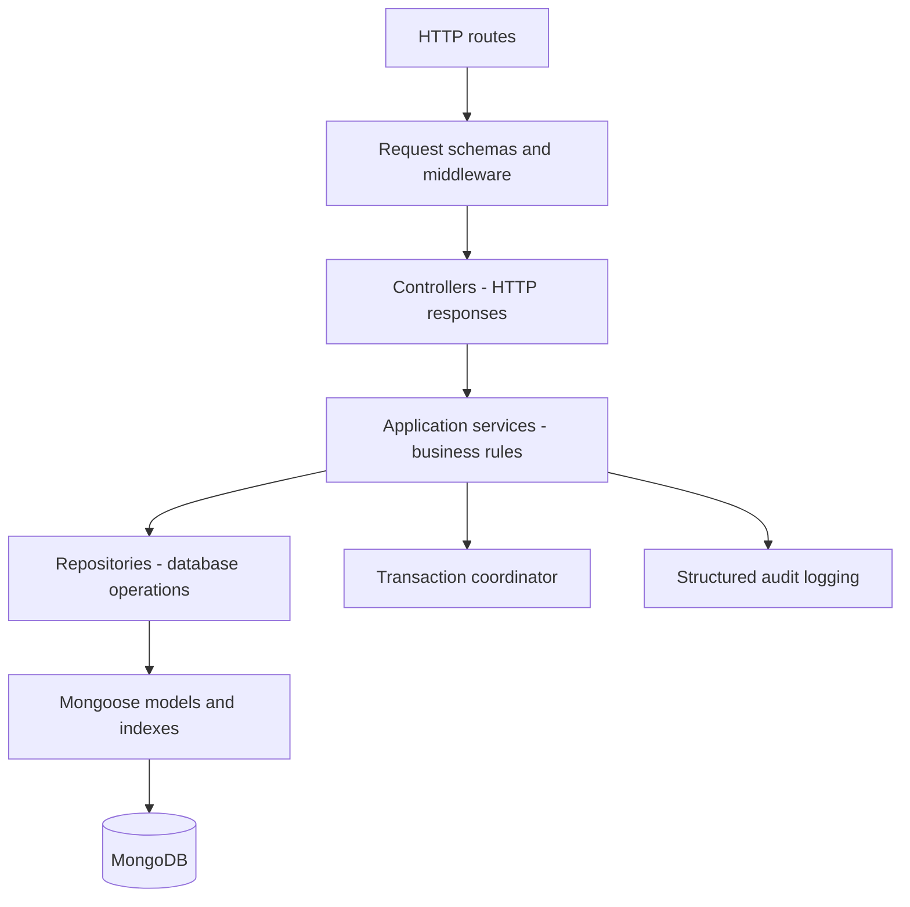
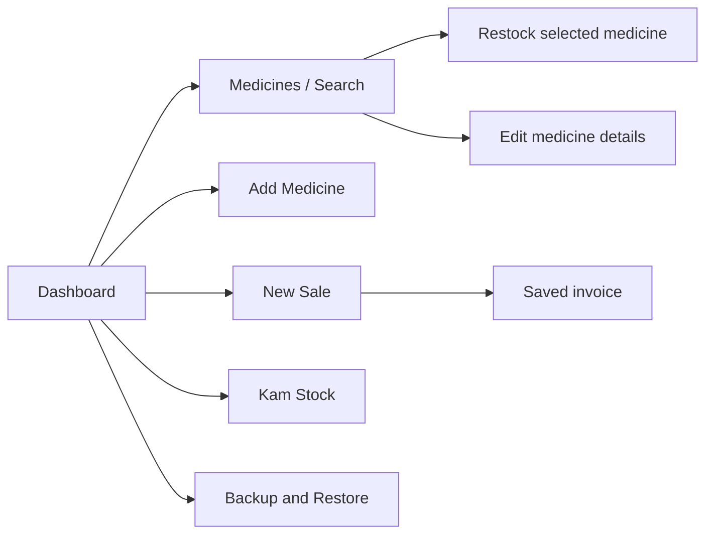
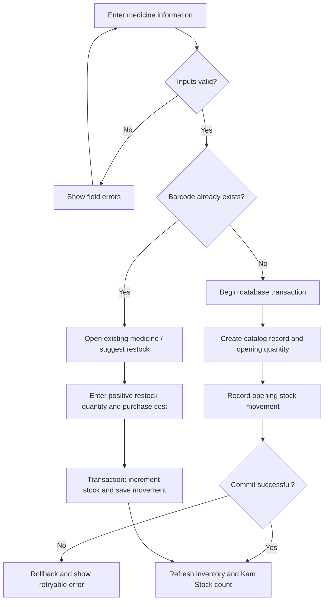
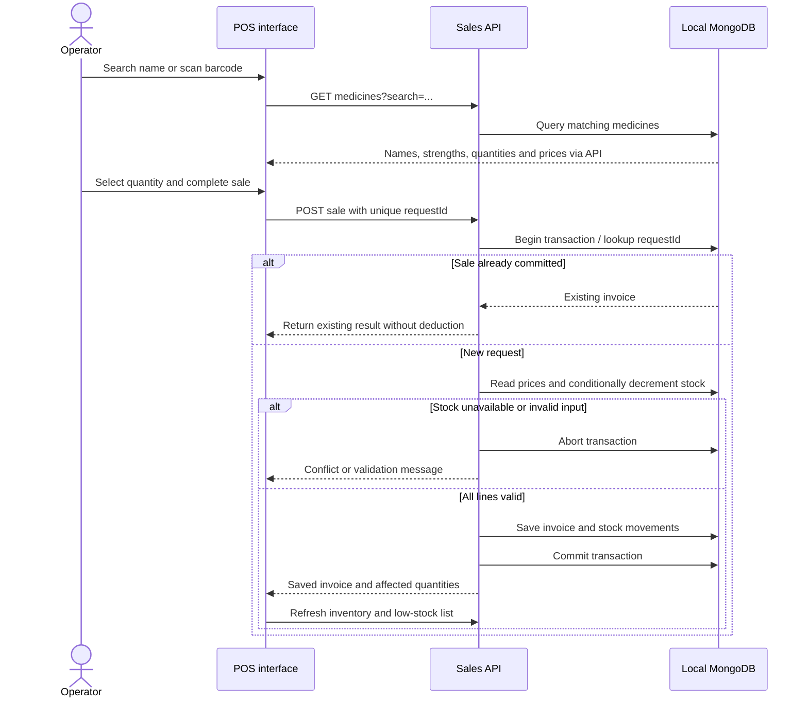
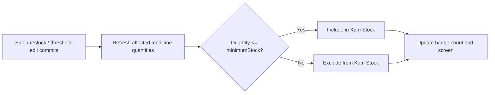
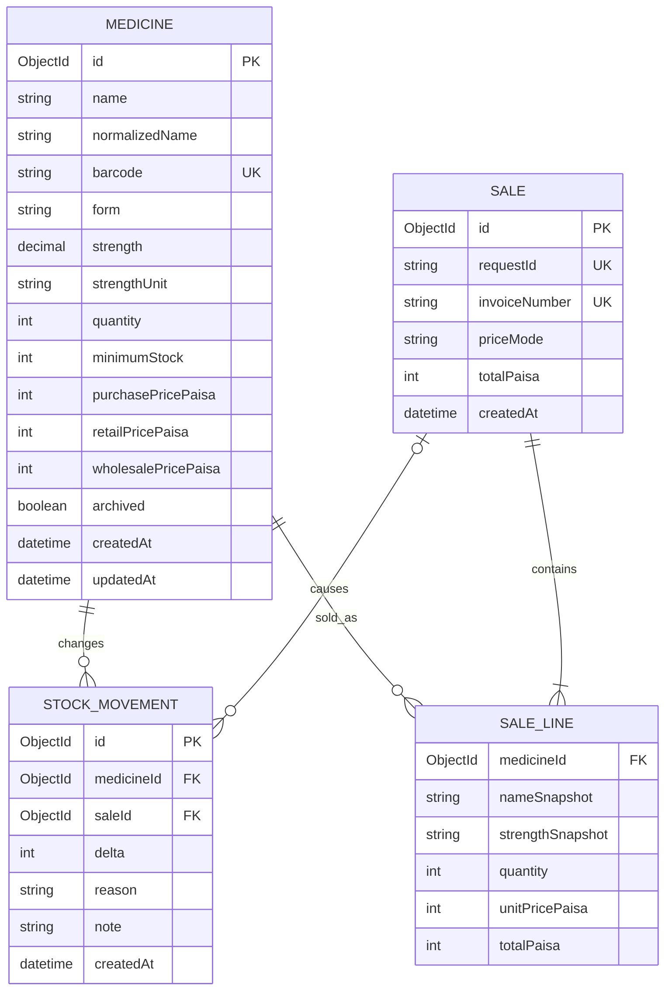
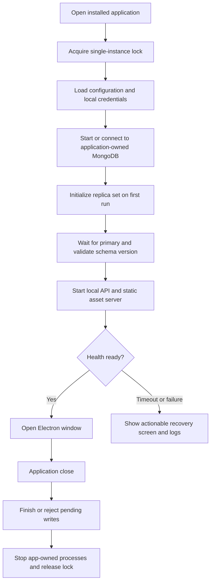

# Pharmacy Desktop System — Architecture Specification

Version 1.0 · 30 October 2026 · Status: proposed design, implementation pending

## 1. Product scope

An offline, single-computer Windows pharmacy system. The operator creates medicines, searches available quantities, records sales and sees low-stock medicines on a dedicated screen. Daily operation requires no network connection. MERN is retained: MongoDB, Express, React through Next.js, and Node.js; Electron supplies the Windows desktop shell.

Initial scope: medicine catalog, opening stock, restocking, selling, minimum-stock alerts, invoices, backup and recovery. Multi-branch sync, online accounts, customer credit, tax integrations and supplier accounting are outside the initial release. Returns, batch/expiry tracking and user roles are future modules, not implied completed features. Batch/expiry tracking should be agreed before commercial pharmacy use; the initial quantity model is per medicine rather than per batch.

## 2. System context



No cloud database, remote fonts, CDN scripts, runtime licensing server or remote authentication is required. Downloads are needed only to prepare releases or obtain an installer.

## 3. Container architecture



Next.js is built as a static export: its routes use client-side local API calls. A small local server serves the exported assets; no Next.js production server or server actions are needed. This reduces offline startup processes. Express and MongoDB remain independent backend components. All local listeners bind to 127.0.0.1. Electron chooses available application ports and injects the API address securely.

## 4. Backend layers and ownership



Routes never write stock directly. InventoryService owns quantity changes; SalesService coordinates pricing, invoices, stock and movements in a single transaction. CatalogService owns names, strengths and prices. BackupService runs only through a restricted Electron command. Controllers translate validation, conflict, unavailable and internal errors into stable API responses.

## 5. Operator navigation



Search results show name, form, strength, available quantity and unit sale prices. Kam Stock shows quantity less than or equal to the medicine's configured minimum; zero quantity is explicitly marked Out of stock. The button displays a count of affected medicines, not a count of units.

## 6. Add medicine and restock flow



Quantity is stored in sellable units: one tablet, capsule, injection, bottle or tube. mg/ml describes strength or volume, not stock count. Opening purchase total is divided by opening unit quantity to derive a purchase cost; decimal arithmetic and rounding rules are applied on the server. This first version does not calculate historical cost of goods sold from restock batches.

## 7. Sale sequence and stock consistency



Duplicate medicine lines are combined before validation. Quantity must be a positive safe integer. The backend selects prices; frontend totals are previews. Conditional quantity updates and transactions protect against two concurrent checkout requests. A unique requestId prevents double deduction after retry or lost responses. A local single-node replica set supports transactions, but does not provide hardware redundancy.

## 8. Low-stock calculation



The list is derived from current database values, not maintained as a second inventory collection. Refresh immediately after a write and whenever the screen opens. Background refresh every five seconds while the screen is visible handles another local window; stale data is marked when the API is unavailable. Server-sent events can be added later if multiple tills are introduced.

## 9. Data model



SALE_LINE is an embedded array in a sale document, shown separately for clarity. Snapshot names/prices preserve historical invoices after catalog edits. Archive medicines instead of deleting records referenced by sales. Barcode uses a partial unique index only for nonempty strings. Other indexes: normalizedName for escaped prefix search, sales.createdAt, unique sales.requestId, unique invoiceNumber, and stockMovements(medicineId, createdAt). Low-stock comparison uses an expression query; monitor performance before adding a derived flag. All monetary calculations use safe integer paisa with explicit overflow and rounding checks. Timestamps use UTC and display in the PC's configured timezone.

## 10. API contract

| Method and route | Responsibility | Main rule |
|---|---|---|
| GET /api/health | Startup/readiness | Report actual database readiness |
| GET /api/medicines?search=&page=&limit= | Search and stock | Bounded pagination; literal prefix search |
| POST /api/medicines | Catalog and opening stock | Name, form, valid prices and integer quantity |
| PATCH /api/medicines/:id | Descriptive fields, prices, threshold | No direct quantity changes |
| POST /api/medicines/:id/restock | Stock receipt | Positive units; transaction and movement |
| POST /api/medicines/:id/adjustments | Explicit correction | Reason required; stock cannot become negative |
| GET /api/stock/low | Kam Stock screen | Include zero quantity; exclude archived records |
| POST /api/sales | Checkout | Unique requestId; atomic stock and sale |
| GET /api/sales/:id | Saved invoice | Read historical snapshot |
| GET /api/sales?page=&limit= | Invoice history | Stable pagination |

Success responses: `{ data, meta? }`. Errors: `{ error: { code, message, fields?, requestId } }`. Use 400 for malformed inputs, 404 for missing records, 409 for duplicate/conflicting stock, 503 for unavailable database and 500 for unexpected failures. Never return raw database stack traces to the operator.

## 11. Windows startup and shutdown



Install binaries under Program Files; store per-user data under `%LOCALAPPDATA%/PharmacyDesktop/` with separate db, logs, backups and config directories. A standard user can run daily operations after setup. Never terminate unrelated MongoDB or Node processes. Do not automatically reset the database on startup errors. Installer and upgrades preserve data; an uninstall removes binaries by default and requires an explicit separate data deletion choice.

## 12. Security and offline operations

- Electron renderer: nodeIntegration disabled, contextIsolation and sandbox enabled. Only allowlisted IPC commands; no arbitrary command or filesystem bridge.
- Load packaged assets only, block unexpected navigation and new windows, and apply a restrictive content security policy.
- API: per-launch secret held in preload/main, allowlisted local origin, input size limits and no network exposure. CORS alone is not authentication.
- MongoDB: loopback binding, authenticated least-privilege application user, local file permissions. Store credentials through Windows-protected storage; do not embed secrets in source.
- Backups: pause new writes, wait for active transactions, create a consistent supported database dump and manifest, verify readability, then resume writes. Never treat a live copy of database files as a verified backup.
- Restore: close database clients, validate backup/schema compatibility, create pre-restore backup, restore into a temporary database and validate before switching. Failure retains existing data.
- Upgrades: local installer, backup before migration, versioned migrations and no automatic downgrade of incompatible data.
- Logs: local rotating files, request IDs and useful failure context; redact credentials. Do not log customer details unnecessarily.

## 13. Proposed source layout

```text
apps/
  desktop/       Electron main, preload, lifecycle, packaging
  web/           Next.js routes, UI components, API client
  api/           Express routes, controllers, services, repositories
packages/
  contracts/     Shared request schemas and response types
  config/        Shared development configuration
docs/            Architecture, diagrams, license inventory
tests/           API integration and desktop acceptance tests
```

Use TypeScript throughout. Keep modules in one backend initially; microservices add no benefit for this single-PC workflow. Lock dependency versions and run installation from the lockfile. Do not ship development tools or development servers.

## 14. Acceptance and release gates

| Scenario | Required result |
|---|---|
| Create 100 tablets; search name | Correct strength and 100 available |
| Sell 7 units | Invoice persists and quantity becomes 93 |
| Threshold 10; sell down to 10 | Kam Stock includes the medicine and badge updates |
| Restock 25 from quantity 10 | Quantity 35; removed from Kam Stock |
| Attempt sale exceeding available stock | No invoice or partial stock change |
| Retry same checkout request | Same invoice; one deduction |
| Simultaneous checkouts | No negative stock or overselling |
| Forced failure before commit | Sale and all stock changes roll back |
| Restart app with internet disabled | Data persists; complete add/search/sell flow works |
| Database cannot start | Recovery screen; no empty database silently created |
| Backup and restore on a clean installation | Invoices, stock and movement totals agree |
| Install/upgrade/uninstall | No unintended data loss; notices included |

Proposed targets to measure on supported hardware: first screen ready within 10 seconds after setup, indexed search within 300 ms at 10,000 medicines, and checkout feedback within 1 second under normal local operation. These are acceptance targets, not measured claims.

## 15. Implementation milestones

1. Approve scope and record packaging/license decisions.
2. Implement backend contracts, models, indexes and local replica-set bootstrap.
3. Verify transactions, concurrency, validation and idempotency against real local MongoDB.
4. Build medicines, sales, Kam Stock and invoice screens.
5. Integrate Electron lifecycle and backup/restore.
6. Verify Windows installer offline on a clean PC and assemble third-party notices.

License inventory and release obligations are recorded in [LICENSES.md](LICENSES.md). This specification describes planned behavior and does not claim an existing working application.
